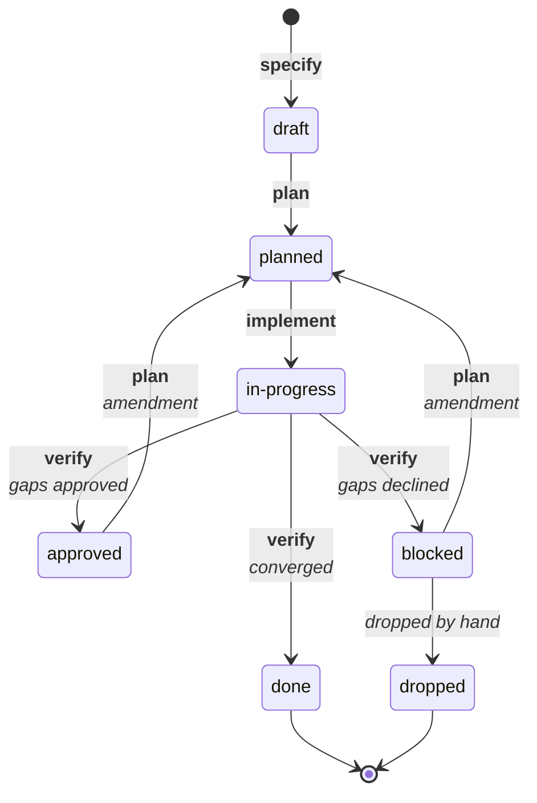

<picture>
  <source media="(prefers-color-scheme: dark)" srcset=".github/assets/banner-dark.svg">
  
</picture>

[](https://github.com/JoDi-27/JoDi-SDD/actions/workflows/ci.yml)
[](https://github.com/JoDi-27/JoDi-SDD/releases/latest)
[](LICENSE)

# JoDi-SDD

Spec-driven development for [Claude Code](https://claude.com/claude-code), as a plugin.

Claude Code is fast, but on bigger features it drifts: it forgets what was decided, says work is done when it isn't, and loses track between sessions. JoDi-SDD turns each piece of work into a written spec that you approve one step at a time (specify → plan → implement → verify), with checks Claude can't skip and a board that tells you and Claude what to do next.

<picture>
  <source media="(prefers-color-scheme: dark)" srcset=".github/assets/demo-dark.svg">
  
</picture>

> Early release (0.x). The workflow is stable, but names and file formats may still change. Feedback and issues are welcome.

## What you get

- **You approve every step.** Each step ends with a review. Nothing moves forward until you run the next command.
- **Tasks are done when their check passes.** Every task has a check command, such as a test. `jsdd done` ticks the task only when that command succeeds, so Claude can't finish work by ticking a checkbox.
- **Reviews in a fresh context.** A reviewer agent that never saw the session that wrote the work checks each plan, and gives a verdict on each acceptance criterion before a spec is closed.
- **Parallel sessions that don't collide.** A session claims a spec or task before it starts. Claims are shared across git worktrees, so several Claude sessions can work on one project without picking up the same work.
- **Open questions get researched before you're asked.** A *spike* is a spec for answering a question rather than building something. A research agent writes a briefing with sources and asks you only what it can't look up. Your answers and the decisions they lead to stay in the project.
- **Existing codebases.** On a project with code, each area is recorded just before work first changes it, as a *baseline* checked by the tests you already have. There's no up-front inventory. See [Existing codebases](#existing-codebases).
- **Traceability.** Each requirement in `docs/requirements.md` has an ID (`FR-AUTH-02`). Specs cite those IDs, tasks cite the spec's acceptance criteria, and commits cite the task. `jsdd coverage` shows which requirements have a spec and which are done.

Everything is plain Markdown in your repository, driven by one bash script. There's no build step and no service.

## How it differs from Spec Kit

[Spec Kit](https://github.com/github/spec-kit) and similar frameworks give the agent better documents: a spec, a plan, a task list, and prompts that check them against each other. That helps, but it leaves the agent in charge of its own progress. The same session writes the code, ticks the task, and reviews the result.

JoDi-SDD is built for Claude Code only, so it can use what Claude Code offers instead of asking the model to behave:

- **Done means the check passed.** In Spec Kit, `/speckit.implement` tells the model to mark each task `[X]` when it's complete, and its checklist gate counts checkboxes. Here, each task names a check command, and `jsdd done` ticks it only when that command exits 0. A task that can only be checked by hand needs a note saying who checked what.
- **Reviews come from a fresh context.** Spec Kit's `/speckit.analyze` and `/speckit.converge` run in the session that wrote the work, which is biased toward it. JoDi-SDD hands each plan, and each spec before it closes, to a read-only reviewer subagent that never saw that session. It judges only what is on disk and gives a verdict per acceptance criterion, with evidence. Like `/speckit.converge`, `/jsdd:verify` also reads the code against each requirement and proposes a fix for each gap. Unlike converge, it adds no tasks itself: it shows you the report, and the fixes you approve go back through `/jsdd:plan` as a reviewed amendment. If you decline, the spec is blocked until you plan them or drop it.
- **Hooks enforce what prompts can only ask for.** The board and the open claims are put into context at the start of every session, so Claude knows what's in progress without being told. A commit whose message doesn't cite a spec or task is blocked before it runs. `STATUS.md` is regenerated whenever a spec or task list is edited, and a session that stops while still holding claims gets a warning.
- **Research happens in its own context too.** A spike's research agent reads the repository and current documentation and settles what it can before you're asked anything. On existing code, a survey agent drafts how an area works today from its code and tests, for you to confirm.
- **Parallel sessions share one board.** Claims live in the git common directory, so sessions in separate worktrees see each other's work and don't pick up the same task. Spec Kit tracks a single active feature in a file you point at by hand.
- **Requirements trace to commits.** Requirement IDs are project-wide, so `jsdd coverage` shows which requirements have a spec, which are in progress, and which are done.

What you give up: Spec Kit works with dozens of coding agents and has a large catalog of extensions and presets. JoDi-SDD works only in Claude Code. If you use another agent, or want Spec Kit's ecosystem, Spec Kit is the better fit.

## Requirements

- Claude Code with plugin support
- `bash`, `awk`, `jq`, and `python3` (already installed on most macOS and Linux machines)
- On Windows: [Git for Windows](https://gitforwindows.org) (Claude Code runs the hooks and `jsdd` in its Git Bash), plus jq and Python: `winget install jqlang.jq Python.Python.3.12`. Without them, the commit-message check and `STATUS.md` regeneration are skipped, and the session-start board says so.
- A git repository is recommended. Sharing claims across worktrees and checking commit messages both need one.

## Install

In the project where you want it:

```sh
claude plugin marketplace add JoDi-27/jodi-sdd --scope project
claude plugin install jsdd@jodi-sdd --scope project
```

Project scope records the plugin in the project's `.claude/settings.json`, so teammates who clone the project are offered it too. Use `--scope user` to install it for all your projects instead. The plugin stays inactive in any project that hasn't run `/jsdd:init`.

## Update and uninstall

To update to the latest release:

```sh
claude plugin update jsdd@jodi-sdd
```

Then start a new session, and run `/jsdd:init` again to pick up any changes to `specs/README.md`. It leaves your other files as they are. [CHANGELOG.md](CHANGELOG.md) lists what changed in each release, including behavior changes.

To uninstall, use the scope you installed with (the default is `user`):

```sh
claude plugin uninstall jsdd@jodi-sdd --scope project
```

Your specs, docs, `PLAN.md`, and `BACKLOG.md` stay in the repository as plain Markdown. Delete them yourself if you no longer want them. Claims are kept in `.git/sdd-claims` (or `specs/.claims` outside git); you can delete that too.

## Quick start

In a Claude Code session in your project:

1. Run `/jsdd:init` to set up the project (see [what it adds](#what-jsddinit-adds)). It then interviews you to fill in the intent, constitution, requirements, decisions, and plan, including your test command. Add notes about the product after the command to pre-fill answers.
2. Start a new session so the hooks pick up the project.
3. `/jsdd:status` shows the board and what to do next.
4. `/jsdd:specify <idea>` writes a spec and asks you the questions that block it.
5. `/jsdd:plan <ID>` approves the spec and writes the plan and tasks, which the reviewer agent checks.
6. `/jsdd:implement <ID>` works through the tasks, ticking each one when its check passes.
7. `/jsdd:verify <ID>` checks every acceptance criterion against evidence and the code against every requirement. If it finds gaps, it shows you a report and asks whether to fix them; `/jsdd:plan <ID>` then plans the fixes as an amendment. Otherwise it closes the spec.

For an open question rather than a feature, run `/jsdd:spike <topic>` instead of steps 4 to 7.

## Spec lifecycle

A feature spec moves through these statuses. Each arrow names the `/jsdd:` command that moves the spec, in bold, and the outcome or reason, in italics. Running a command is your approval of the step before.



- **approved:** a spec comes back here when you approve the fixes for gaps that verification found. (`/jsdd:plan` also sets it at the start of a first run, so a new spec stays at `approved` only if that run stopped partway; running `/jsdd:plan` again finishes it.)
- **converged:** every acceptance criterion passes with evidence, and the code does what each requirement says, with nothing extra and no unrecorded drift from the plan.
- **gaps:** `/jsdd:verify` only judges. It writes `verify-report.md` in the spec folder, with a numbered proposed action for each gap (G1, G2, …), and asks whether to fix them. It changes no tasks, plan, or spec. Approve, and the spec goes back to `approved`. Decline, and only the report is kept and the spec is `blocked`.
- **amendment:** `/jsdd:plan` on a spec with an approved or declined report plans the gaps as an amendment. It adds a numbered section (A1, A2, …) to the plan's Amendments, saying what each gap became: follow-up tasks, a spec change, a Deviation, or a BACKLOG item. The follow-up tasks go in `tasks.md` under their own heading, and each names its gap. The reviewer checks the amendment, and `/jsdd:implement` builds it as usual. If the amendment needs no tasks, the spec goes straight back to `in-progress` for `/jsdd:verify`.
- **blocked:** `jsdd next` shows the spec as waiting on a declined verification. Running `/jsdd:plan <ID>` is your approval to fix the gaps after all; otherwise, drop the spec. A spec can also be blocked or dropped by hand at any stage, with the reason in its changelog.

Spikes and baselines skip the plan: they go `draft → in-progress → done`. See [starters/specs/README.md](starters/specs/README.md#lifecycle).

## Existing codebases

The kit works on a project that already has code. It doesn't ask you to document the whole codebase up front. Instead, it records how an area works today just before new work first changes it:

1. `/jsdd:init` notices the existing code. It surveys the codebase for its areas, test command, and conventions, and plans the next milestone rather than an MVP. If the project already has its own `PLAN.md` or `docs/requirements.md`, init offers to move it to `docs/legacy/` and carry its content into the kit's format. The same goes for documents under other names, such as a `VISION.md`, a PRD, or a folder of ADRs: init reads them and proposes which starter each one feeds, for you to confirm. It never overwrites a file.
2. Before a feature changes an area that has no requirements yet, `/jsdd:baseline <area>` reads that area's code and tests and drafts what it does today. You confirm which behavior is intended. Those become requirement rows and a *baseline spec*, whose acceptance criteria are the existing tests.
3. `/jsdd:verify` runs those tests. When they pass, the baseline is done and its requirements count as done, without anything being rebuilt.
4. The feature spec then cites the rows it changes. Coverage shows them in progress again until the feature is verified.

Areas no work touches stay unrecorded. `/jsdd:specify` suggests a baseline when a feature reaches existing code that has none.

The full workflow, including spec statuses, IDs, and the commit-message format, is in [starters/specs/README.md](starters/specs/README.md). `/jsdd:init` copies it into your project as `specs/README.md`.

## Commands

| Command | What it does |
| --- | --- |
| `/jsdd:init [notes]` | Sets up the project, then interviews you to fill in its starter files |
| `/jsdd:status [ID]` | Shows the board, what to do next, and requirement coverage |
| `/jsdd:specify <idea, PLAN item, or ID>` | Creates or refines a feature spec |
| `/jsdd:spike <topic or ID> [notes]` | Runs a spike: research first, then questions for you |
| `/jsdd:plan <ID>` | Approves the spec, then writes the plan and tasks; after a verification with gaps, plans the fixes as an amendment |
| `/jsdd:implement <ID> [task]` | Works through the tasks |
| `/jsdd:baseline <area or ID>` | Records how an area of existing code works today, checked by its existing tests |
| `/jsdd:verify <ID>` | Checks the acceptance criteria (or a spike's answers) and the code against the spec, then closes it, or reports gaps for your approval |

Under the hood, these commands use the `jsdd` CLI, which the plugin adds to the PATH for Claude's Bash tool. Run `jsdd help` for its subcommands.

## What `/jsdd:init` adds

| Path | Contents |
| --- | --- |
| `docs/intent.md` | What you are building and why |
| `docs/requirements.md` | Requirements with IDs (`FR-`, `NFR-`) and priorities |
| `docs/decisions.md` | Settled decisions (`DEC-nn`) and open ones (`ND-nn`) |
| `PLAN.md` | Phases, each item tagged with the requirements it covers |
| `BACKLOG.md` | One line per open decision with a suggested default, and spikes with their questions |
| `specs/constitution.md` | Rules every plan is checked against, plus your project's test command and architecture rules |
| `specs/README.md` | How the workflow runs |

These are your files. Running `/jsdd:init` again only updates `specs/README.md`, when a new plugin version changes it, and never overwrites the others.

## Contributing

See [CONTRIBUTING.md](CONTRIBUTING.md) for how the plugin is laid out, how to test changes locally, and how to add a new command. Report security issues privately, as described in [SECURITY.md](SECURITY.md).

## License

[MIT](LICENSE)
