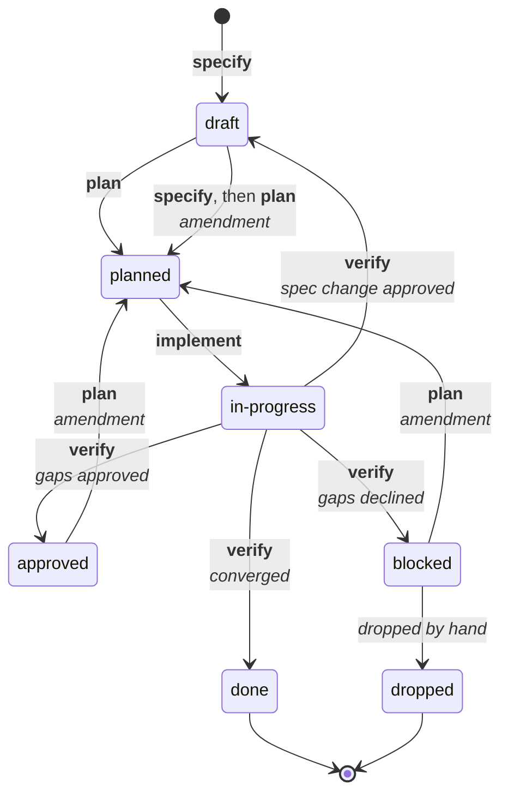

# Your first feature

A walkthrough of one feature on a new project, from `/jsdd:init` to a closed spec. On a project that already has code, read [Existing codebases](existing-codebases.md) first.

In a Claude Code session in your project:

**1. Set up the project.** Run `/jsdd:init`. It adds a handful of Markdown files (listed in the [README](../README.md#what-jsddinit-adds)), then interviews you to fill them in: what you're building, the rules every design must respect, the requirements with their priorities, open decisions, and a phased roadmap, including your test command. Add notes after the command to pre-fill answers. On a project that already has code, it surveys the code first and plans the next milestone instead of an MVP.

**2. Start a new session.** The hooks that print the board and guard commits load at session start, so they don't run in the session that installed them.

**3. Specify.** `/jsdd:specify Password reset by email` creates `specs/001-password-reset/spec.md` and asks you what it can't decide alone. The result reads like this:

```markdown
## Requirements
- **R1** (FR-AUTH-02) When a user asks to reset their password, the system shall
  email a single-use link that expires after 30 minutes.

## Acceptance criteria
- **AC-1** A reset link used after 30 minutes is rejected, and the user is told
  to request a new one.
```

Anything unknown is written as `[NEEDS CLARIFICATION: …]` rather than guessed, and the next step won't start until it's resolved.

**4. Plan.** `/jsdd:plan 001` is your approval of the spec. Claude writes the design and a task list, and a reviewer agent in a fresh context checks both against the spec and your project's rules. Each task names what it touches, how it is checked, and the criterion it serves:

```markdown
- [ ] **T3** Reject expired reset tokens · `auth/reset.py` · check: `pytest tests/test_reset.py -k expired` → AC-1
```

**5. Implement.** `/jsdd:implement 001` is your approval of the plan. Claude claims one task at a time, does it, and runs `jsdd done 001 T3`, which runs the task's check and ticks the task only if the check passes. A failing check leaves the task unticked, however finished Claude says it is. Each task is committed with a message that cites it, such as `[001] T3 Reject expired reset tokens`.

**6. Verify.** `/jsdd:verify 001` checks every acceptance criterion with evidence and reads the code against every requirement, with a second verdict from the reviewer agent. If everything holds, the spec is closed and the roadmap and board are updated. If it finds gaps, it writes a report with a proposed fix for each and asks whether to apply them. Say yes, and `/jsdd:plan 001` plans the fixes as a reviewed amendment; say no, and the spec is blocked until you decide.

**7. Next.** `/jsdd:status` shows the board and the next command to run.

<details>
<summary>What the board looks like</summary>

```text
| ID  | Type    | Status      | Phase | Progress | Open Qs | Depends on | Title                   |
| --- | ------- | ----------- | ----- | -------- | ------- | ---------- | ----------------------- |
| 001 | feature | done        | 1     | -        |         |            | Password reset by email |
| 002 | feature | in-progress | 1     | 3/6      |         |            | Session expiry          |
| 003 | spike   | draft       | 0     | 0/3      |         |            | Which email provider?   |

3 specs: draft 1, in-progress 1, done 1

Next up:
  002  in-progress Session expiry          /jsdd:implement 002   (T4 free)
  003  draft       Which email provider?   /jsdd:spike 003
```

</details>

## What verify can do to a spec

A feature spec moves through these statuses. Each arrow names the `/jsdd:` command that moves the spec, in bold, and the outcome, in italics. Running a command is your approval of the step before.



- **Converged:** every acceptance criterion passes with evidence, and the code does what each requirement says, with nothing extra and no unrecorded drift from the plan. The spec is `done`.
- **Gaps:** verify only judges. It writes `verify-report.md` in the spec folder, with a numbered proposed action for each gap (G1, G2, …), and asks whether to fix them. Approve, and the spec goes to `approved`; `/jsdd:plan` then adds the fixes to the plan as a numbered amendment (A1, A2, …) with follow-up tasks, which the reviewer checks and `/jsdd:implement` builds as usual.
- **Spec change:** when a fix you approve changes the spec itself, the spec goes back to `draft`. `/jsdd:specify 001` revises it with you, and `/jsdd:plan 001` approves the revision and plans the rest as an amendment.
- **Declined:** only the report is kept and the spec is `blocked`. Running `/jsdd:plan 001` later is your approval to fix the gaps after all; otherwise, drop the spec.
- **Two rounds:** a gap on the same criterion that survives two rounds of fixes means the spec or its check is likely wrong, so verify offers only a spec change or dropping the gap, not a third fix.

Spikes and baselines skip the plan: they go `draft → in-progress → done`. The full status table is in [specs/README.md](../starters/specs/README.md#lifecycle).

The terms are in the [glossary](../GLOSSARY.md).
